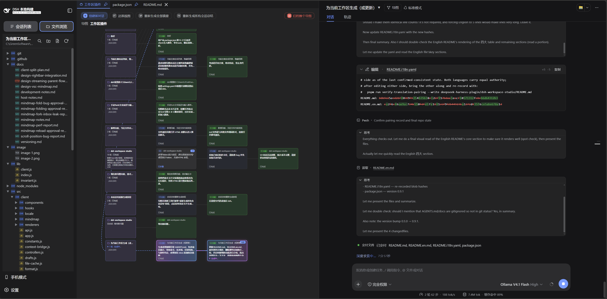

# 🗂️ Workspace Studio

> Turn DeepSeek Harness Web into an IDE-style three-pane workspace: **files, previews, editor, mind map, music workshop, and chat on one screen**.

English | [中文](README.md) · MIT · Harness bundle plugin

One plugin replaces Harness's root layout: sessions / workspace collections / file tree on the left, preview tabs and a CodeMirror 6 editor in the middle, chat on the right. File management, run console, command file permissions, Git / SVN status, conversation-branch mind map, AI music workshop, and token stats all ship in one package. **No Harness source changes**; uninstalling restores the built-in layout. Open a workspace, edit code, run scripts, review diffs, branch a conversation, or write a score — all on one page.

The preview pane sits left of the chat by default and can move to the right in settings. The session-header **Mind map** button opens the branch map as a preview tab while the chat stays usable.

## 📸 Screenshots

|  |  |
|---|---|
| Three-pane layout: sidebar + preview / editor + chat | Mobile mode: centered phone-column layout |

## ✨ Highlights

| Feature | What you get |
|---|---|
| 🧭 **Three-pane workspace** | Sidebar, preview / editor, and chat on one screen; move the preview to the right, keep the chat usable, and open tool details in a right-side drawer. |
| 🗂️ **File tree & search** | Directory tree, content / name search, Git / SVN status, changes-only and ignored filters; create from the tree header, rename / copy / move / delete from the context menu. |
| 📑 **Preview tabs** | Per-session restore, pin, drag to reorder, **split into top and bottom panes**; dedicated renderers for Markdown / HTML / images / PDF / Office. |
| ✏️ **Edit on open** | CodeMirror 6, 14 encodings, staging drafts, three-way merge on save; diff marks plus a scrollbar change ruler, and **never a silent overwrite**. |
| 🏃 **Run console** | Run scripts and `.exe` files in the lower half of the preview with live stdout / stderr; interpreters are configurable per file or per extension. |
| 🛡️ **Command file permissions** | Analyze which files an Agent `bash` / `pwsh` command will write before it runs; prompt for unrecorded targets, persist grants, and pause per scope. |
| 🧭 **Conversation branch map** | Fork at any turn, click to switch, watch streaming turns, use optional AI summaries, and fold cards — while the chat stays open. |
| 🎼 **AI Music Workshop** | 12 VCSL instruments, multi-track arrangement, piano roll and 16-step drums, AI composition, chat collaboration, chat auto-generation, and WAV / MIDI export. |
| 🎯 **Editor context** | Inject the open file, selected code, or score state into the conversation; collapse it to a one-line chip and keep titles clean. |
| 📊 **Collections / mobile / token stats / updates** | Filter workspaces by collection; switch to the phone-column layout; inspect per-model usage; update the plugin from Settings. |

## 🚀 Three common workflows

### 1. Read, edit, and run code

- Open a file from **File Explorer**: **single click = temporary tab** (italic), **double click = permanent tab**; tabs are restored per session.
- **Split the preview** top/bottom: source on one side, rendered Markdown / HTML on the other; images, PDFs, and Office documents preview in place.
- Editing starts on open; changes are staged outside the workspace, and `Ctrl/Cmd+S` performs a **three-way merge** against the disk with per-hunk conflict choices.
- Changes are drawn directly in the editor: added / modified / deleted marks, line tint, and a scrollbar change ruler, relative to Git `HEAD` / SVN `BASE`.
- Scripts and `.exe` files get a **run console** below the preview: run / stop / rerun / clear / copy / follow, with exit code and elapsed time.

### 2. Turn one conversation into a mind map

- Click **Mind map** in the session header: the map opens as a preview tab while the chat keeps running.
- **Click a leaf card to switch branches**; click a middle turn to **fork a new branch there**. Every branch belongs to the same map.
- A generating session shows a **Generating…** card with a flowing halo and dashed edge; click it to follow the live output.
- Optional AI card summaries; hover a card to fold it into an **×N folded card**; pan with the hand tool and zoom with the wheel.
- Deleting a card **truncates the conversation** at that point; archiving the whole map has no restore path, so both ask for confirmation first.

### 3. From one sentence to a piece of music

- **Right-click the tab strip → Open Music Workshop**.
- Create tracks from 12 VCSL sample instruments and arrange them on the timeline; write melodies in the piano roll and drums in the 16-step machine.
- **AI composition** takes a description plus style / mood / duration / instruments; keep editing afterwards, with per-track undo / redo.
- **Chat collaboration**: say "make the piano sparser in bar 3" in the conversation and only that track changes; the piece's BPM / key / bar count / chord progression stay locked.
- **Chat auto-generation**: say "generate an 8-bar lofi piano piece and export WAV"; the plugin opens a new tab, composes, saves, and exports.
- **Export** WAV (44.1 / 48 kHz, 16 / 24 bit, mono / stereo), MIDI (multi-track), or a `.music.json` project.

## ⚡ Quick start

### Web

In Git Bash, WSL, or Linux, enter the plugin directory:

```sh
cd <plugin-dir>
bash ./install.sh          # installs into the web profile by default
```

Then **stop and restart the existing Web process** and refresh `http://127.0.0.1:3080`. The script does not start a second server.

Install directly from Git (pinned to the current HEAD commit):

```sh
bash ./install.sh --git
```

### Desktop

Open the Desktop **Plugins** page → **Add plugin**, and enter:

```
github:yishengjun8/dsh-workspace-studio
```

**Quit and reopen the Desktop app** after installing (a page refresh does not reload its bundled front end).

### First five things to try

1. Switch the left sidebar to **File Explorer**, single-click one file (temporary tab), then double-click another (permanent tab).
2. Edit a few lines, press `Ctrl/Cmd+S`, and watch the diff summary in the status bar.
3. Open a `.py` / `.sh` / `.exe` file and press **Run** in the console below.
4. Click **Mind map** in the session header and try switching branches and forking a turn.
5. Right-click the tab strip → **Open Music Workshop**, then ask the AI for a short piece.

## ⚙️ Where to change things

Everything lives under **Harness Settings → Workspace Settings**:

| What you want to change | Card |
|---|---|
| Preview side, base font size, row height, auto-sync | Browsing & preview |
| File icon colors, syntax highlight presets | Icon & highlight colors |
| Git / SVN display, diff marks, scrollbar ruler | Version control |
| Agent command file gate and AI fallback | Command file permissions |
| Mind map colors, links, AI summaries | Mind map |
| Per-extension interpreters, file-level overrides | Custom interpreters |
| Music save directory, 100% zoom baselines | Music workshop |
| Plugin updates, Token stats | Maintenance & stats |

### Common configuration

Most deployment knobs live in the plugin row of `cordis.patch.yml`; the full schema is in `src/host/index.js`.

| Field | Default | Purpose |
|---|---:|---|
| `enableEditing` | `false` | Enables the Host write API (this bundle sets it to `true`). |
| `maxPreviewBytes` | `1048576` | Text preview limit per file. |
| `maxSiteBytes` | `33554432` | Per-subresource limit for the HTML preview site. |
| `enableVcsStatus` | `true` | Master switch for Git / SVN status in the file tree. |
| `enableCommandPermissions` | `true` | Deployment-level switch for the command file gate. |
| `enableMusicChat` | `true` | Registers the `music_compose` tool used by chat auto-generation. |
| `maxCollections` | `50` | Maximum number of user-created workspace collections. |
| `enableUpdateCheck` | `true` | Allows "check for updates" and "download and update". |

## 🔒 Security boundaries

- **Workspace path fence**: only relative paths inside a registered workspace are accepted; `..`, absolute paths, symlinks that escape the workspace, and Windows reserved names are rejected.
- **Write protection**: a save must carry the `If-Match` revision it read; conflicts never overwrite. Files are written through a same-directory temp file and an atomic rename, preserving permissions where possible.
- **Read-only version control**: only `git status` / `svn status` and `git show` / `svn cat`; no staging, commits, network access, or `index.lock` writes.
- **The run console is not a sandbox**: it executes the file you choose with your user rights. The first run asks for confirmation, and Stop terminates the whole process tree.
- **Command file permissions are an execution-time prompt, not a sandbox**: scripts, variable expansion, or aliases can still write outside the recorded paths; hard isolation still comes from Harness's sandbox / approval presets.
- **HTML preview tokens** are short-lived and read-only (30 minutes) and only serve the document's own workspace; the route is not a general file API.

## 🖥️ Web and Desktop

There is no separate Desktop build: both ends share the same Web front end and the same Host composition. Only the profile, the page origin, and the restart path differ.

| | Web | Desktop |
|---|---|---|
| Profile | `$DSH_HOME/profiles/web` | `$DSH_HOME/profiles/desktop` |
| Page origin | `http://127.0.0.1:3080` | `dsh-app://app` |
| Install | `install.sh` / Plugins page | Desktop **Plugins** page only |
| Activation | Restart the Web process + refresh | Quit and reopen the app |

UI state is stored per page origin (localStorage); drafts, mind maps, collections, permission records, and other Host data are shared by both ends.

## 📦 Compatibility

- Current development baseline: Harness `0.2.2-rc.5` (local Web checkout). The Desktop app bundles its own dsh version; the first verified build was `0.2.0-rc.2`, and the same artifact remains compatible.
- Requires Harness to provide `conversation.input.dock`, the session send service, `ctx.sidebarRight.openResource`, and `ctx.sessions.fork`; these seams are encapsulated in the plugin, so a Harness upgrade usually only needs a plugin update.
- Requires the shell to provide the `@deepseek-ai/dsh-client-ui-primitives` platform seed (`CodeBlock` / `MarkdownText`, etc.).

## 🧰 Development

```sh
pnpm install --config.auto-install-peers=false
npm run bundle     # src/client → lib/client.js, src/host → lib/index.js
npm run check      # six zero-dependency gates: dual-target / modules / contract / API / locale / music collaboration
```

Commit the rebuilt artifacts: Git installs and the plugin updater consume `lib/` from the repository. **Do not modify Harness source**; every bridge lives in this package and is restored on uninstall.

## ⚠️ Caveats

- Office previews depend on Harness's `officeToPdf` service and a local LibreOffice installation; the tab explains when the service is missing.
- Diff marks are skipped for very large files (over 20,000 lines or 2 MB) or an unreadable baseline; the scrollbar ruler only works in Chromium-based browsers.
- The Music Workshop does not support MP3 yet; v1 / v2 scores no longer open; an offline WAV render cannot be cancelled.
- Deleting a mind-map card or archiving the whole map has no restore path for the original sessions.
- The macOS Desktop app has not been tested; Desktop self-updates do not change the git install's lockfile bookkeeping.

## 📄 License

- This plugin: MIT, see [LICENSE](LICENSE).
- Bundled VCSL sample pack: CC0 1.0; see [assets/vcsl/LICENSE.txt](assets/vcsl/LICENSE.txt) and [assets/vcsl/sources.json](assets/vcsl/sources.json).
- CodeMirror 6 / Lezer / `marked` and other third-party notices: [THIRD_PARTY_NOTICES.md](THIRD_PARTY_NOTICES.md).

---

If this plugin is useful to you, a Star ⭐ or an Issue is welcome: <https://github.com/yishengjun8/dsh-workspace-studio>
