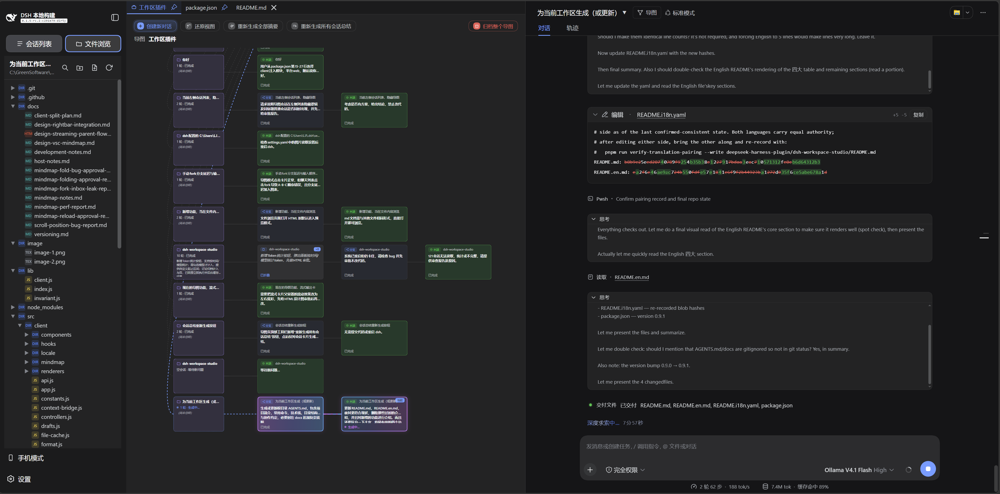

# 🗂️ 工作区 Studio

> 把 DeepSeek Harness Web 变成 IDE 式三栏工作台：**文件、预览、编辑器、导图、音乐工坊与对话同屏**。

[English](README.en.md) | 中文 · MIT · Harness bundle 插件

一个插件替换 Harness 的根布局：左侧会话 / 工作区合集 / 文件树，中间预览标签与 CodeMirror 6 编辑器，右侧对话。文件管理、运行控制台、命令文件权限、Git / SVN 状态、会话分支导图、AI 音乐工坊与 Token 统计都在同一个包里，**不修改 Harness 源码**，卸载后内置布局自动恢复。打开工作区、改代码、跑脚本、看 diff、拉分支、写配乐，都在这一页完成。

预览栏默认在对话左侧，可在设置里切到右侧；会话头部的「导图」按钮把分支导图作为预览标签打开，聊天保持可用。

## 📸 界面预览

|  |  |
|---|---|
| 三栏布局：侧栏 + 预览 / 编辑器 + 对话 | 手机模式：居中的手机竖屏列 |

## ✨ 核心特性

| 特性 | 亮点 |
|---|---|
| 🧭 **三栏工作台** | 侧栏 + 预览 / 编辑 + 对话同屏；预览可切到右侧，聊天区始终可用，工具详情以右侧抽屉覆盖。 |
| 🗂️ **文件树与搜索** | 目录树、内容 / 文件名搜索、Git / SVN 状态、仅看变更、忽略项；树头新建，右键重命名 / 复制 / 移动 / 删除。 |
| 📑 **预览标签** | 按会话恢复、固定、拖拽重排、**上下拆分双栏**；Markdown / HTML / 图片 / PDF / Office 各有渲染视图。 |
| ✏️ **打开即改** | CodeMirror 6、14 种编码、暂存盘草稿、保存时三方合并；差异色标 + 滚动条变更刻度，永不静默覆盖。 |
| 🏃 **运行控制台** | 预览脚本 / `.exe` 时下方直接运行，stdout / stderr 实时回看；解释器可按文件或按后缀自定义。 |
| 🛡️ **命令文件权限** | Agent 的 `bash` / `pwsh` 执行前分析要写哪些文件；未授权先弹窗，记录持久化，可按作用域暂停。 |
| 🧭 **会话分支导图** | 任意轮次 fork、点击切换、流式输出可视化、AI 摘要、卡片折叠；导图与聊天同时使用。 |
| 🎼 **AI 音乐工坊** | 12 种 VCSL 音色、多轨编曲、钢琴卷帘 / 鼓机、AI 谱曲、会话协作、对话自动生成、WAV / MIDI 导出。 |
| 🎯 **编辑器上下文** | 打开的文件、选中的代码或乐谱状态注入对话；气泡折叠成一行摘要，标题自动净化。 |
| 📊 **工作区合集 / 手机模式 / Token 统计 / 插件更新** | 侧栏按用途过滤工作区；手机竖屏；按模型统计用量；设置页一键更新。 |

## 🚀 三种最常用的工作流

### 1. 读代码、改代码、跑代码

- 左侧「文件浏览」打开文件：**单击 = 临时标签**（斜体），**双击 = 正式标签**；标签按会话恢复。
- 预览列可**上下拆分**：一边看源码，一边看 Markdown / HTML 渲染；图片、PDF、Office 文档直接预览。
- 打开即编辑；修改先写工作区外的暂存盘，`Ctrl/Cmd+S` 保存时与磁盘**三方合并**，冲突逐处选择。
- 改动直接标在编辑器里：新增 / 修改 / 删除色标、行底色、滚动条变更刻度，相对 Git `HEAD` / SVN `BASE`。
- 脚本或 `.exe` 的预览下方有**运行控制台**：运行 / 停止 / 重跑 / 清空 / 复制 / 跟随，退出码与用时一目了然。

### 2. 把一条对话变成导图

- 会话头部点「**导图**」：导图在预览区标签打开，聊天继续。
- **点击链尾卡片 = 切换分支**；点击中间轮次 = **在那里 fork 新分支**，所有分支归同一张导图。
- 生成中的会话显示「**生成中…**」卡片、流动光环与虚线；点击即可切过去实时看输出。
- 可选 AI 卡片摘要；悬浮卡片可折叠成 **×N 折叠卡**；画布支持抓手平移与滚轮缩放。
- 删除卡片 = 从该处**真截断**；归档整个导图后当前无恢复入口，操作前会二次确认。

### 3. 从一句话到一首曲子

- **右键标签栏 →「打开音乐工坊」**。
- 从 12 种 VCSL 采样音色新建音轨，在时间轴上编曲；旋律用钢琴卷帘写，鼓组用 16 步鼓机。
- **AI 谱曲**：描述 + 风格 / 情绪 / 时长 / 乐器，生成后可继续手改；撤销 / 重做按音轨记录。
- **会话协作**：在右侧对话里说「钢琴第 3 小节别那么密」，模型只改那一条轨，整曲 BPM / 调性 / 小节数 / 和声锁死。
- **对话自动生成**：说「生成一首 8 小节的 lofi 钢琴曲，导出 WAV」，自动开新标签、谱曲、保存并按格式导出。
- **导出**：WAV（44.1 / 48 kHz、16 / 24 bit、单 / 立体声）、MIDI（多轨）或 `.music.json` 工程。

## ⚡ 快速上手

### Web 端

在 Git Bash、WSL 或 Linux 中，进入插件目录：

```sh
cd <插件目录>
bash ./install.sh          # 默认安装到 web profile
```

然后**停止并重启原有的 Web 进程**，刷新 `http://127.0.0.1:3080`。脚本不会启动第二个服务器。

从 Git 直接安装（锁定当前 HEAD 提交）：

```sh
bash ./install.sh --git
```

### 桌面端

桌面端「插件」页 →「添加插件」，填入：

```
github:yishengjun8/dsh-workspace-studio
```

安装后**退出并重新打开桌面端 App**（桌面端刷新页面不生效，它加载的是打包内的前端）。

### 第一次打开，先试这 5 件事

1. 左侧切到「**文件浏览**」，单击一个文件（临时标签），再双击另一个（正式标签）。
2. 改几行字，按 `Ctrl/Cmd+S` 保存，看底部状态栏的差异摘要。
3. 打开一个 `.py` / `.sh` / `.exe`，在下方控制台点「运行」。
4. 点会话头部的「**导图**」，在任意卡片上试试切换与 fork。
5. 右键标签栏 →「打开音乐工坊」，让 AI 谱一段。

## ⚙️ 常用入口

所有设置都在 **Harness 设置 → 工作区设置**：

| 想改什么 | 去哪张卡片 |
|---|---|
| 预览在左 / 右、基础字号、行高、自动同步 | 浏览与预览 |
| 文件图标颜色、代码高亮预设 | 图标与高亮配色 |
| Git / SVN 显示、差异色标、滚动条刻度 | 版本控制 |
| Agent 命令写文件的拦截与 AI 兜底 | 命令文件权限 |
| 导图颜色、连线、AI 摘要 | 导图 |
| 每种后缀的解释器、文件级覆盖 | 解释器 |
| 音乐默认目录、100% 缩放基准 | 音乐工坊 |
| 插件更新、Token 统计 | 维护与统计 |

### 常用配置

多数部署参数在 `cordis.patch.yml` 的插件 row 里调整；完整字段见 `src/host/index.js` 的 `Config` schema。

| 字段 | 默认值 | 作用 |
|---|---:|---|
| `enableEditing` | `false` | 是否启用 Host 写入接口（本 bundle 已设为 `true`）。 |
| `maxPreviewBytes` | `1048576` | 单文件文本预览上限。 |
| `maxSiteBytes` | `33554432` | HTML 预览单个子资源上限。 |
| `enableVcsStatus` | `true` | 文件树 Git / SVN 状态总开关。 |
| `enableCommandPermissions` | `true` | 命令文件权限的部署级总开关。 |
| `enableMusicChat` | `true` | 是否注册对话自动生成曲子的 `music_compose` 工具。 |
| `maxCollections` | `50` | 自建工作区合集上限。 |
| `enableUpdateCheck` | `true` | 是否允许「检查更新 / 下载并更新」。 |

## 🔒 安全边界

- **工作区路径围栏**：只接受已登记 Workspace 内的相对路径；`..`、绝对路径、越界符号链接与 Windows 保留名一律拒绝。
- **写入保护**：保存必须携带读取时的 `If-Match` 修订版本，冲突不覆盖；同目录临时文件 + 原子重命名，尽量保留权限。
- **版本控制只读**：只调用 `git status` / `svn status` 与 `git show` / `svn cat`，不暂存、不提交、不联网、不写 `index.lock`。
- **运行控制台不做沙箱**：它用当前用户权限执行你选的文件；首次运行需确认，停止会终止整个进程树。
- **命令文件权限是执行前提示，不是沙箱**：脚本内部、变量拼接或别名仍可能写到记录之外；硬隔离仍靠 Harness 的 sandbox / 审批预设。
- **HTML 预览令牌**：短期只读（30 分钟），只服务该文档所属工作区；它不是通用文件接口。

## 🖥️ Web 与桌面端

没有单独的桌面端构建：两端共用同一份 Web 前端与同一个 Host 组合，区别只在 profile、页面源与重启方式。

| | Web 端 | 桌面端 |
|---|---|---|
| profile | `$DSH_HOME/profiles/web` | `$DSH_HOME/profiles/desktop` |
| 页面源 | `http://127.0.0.1:3080` | `dsh-app://app` |
| 安装 | `install.sh` / 插件面板 | 只走桌面端「插件」页 |
| 生效 | 重启 Web 进程 + 刷新 | 退出并重新打开 App |

界面状态按页面源各存一份（localStorage）；草稿、导图、合集、权限记录等 Host 数据两端共享。

## 📦 兼容性

- 当前开发基线：Harness `0.2.2-rc.5`（Web 端本机 checkout）；桌面端内置 dsh 版本由发行版固定，首次实测为 `0.2.0-rc.2`，同一份产物兼容。
- 需要 Harness 提供 `conversation.input.dock`、会话发送服务、`ctx.sidebarRight.openResource` 与 `ctx.sessions.fork` 等接口；这些 seam 都封装在插件内，升级 Harness 后通常只需更新插件。
- 需要 shell 提供 `@deepseek-ai/dsh-client-ui-primitives` 平台种子（`CodeBlock` / `MarkdownText` 等）。

## 🧰 开发

```sh
pnpm install --config.auto-install-peers=false
npm run bundle     # src/client → lib/client.js，src/host → lib/index.js
npm run check      # 六道零依赖自查：双端 / 模块 / 契约 / API / 双语 / 音乐协作
```

构建产物需要一起提交：git 安装与「插件更新」直接使用仓库里的 `lib/`。**不要修改 Harness 源码**；所有桥接都在本包内完成，卸载时按原样恢复。

## ⚠️ 注意

- Office 预览依赖 Harness 的 `officeToPdf` 服务与本机 LibreOffice；服务缺失时标签会给提示。
- 差异色标在文件过大（>2 万行或 >2 MB）或基线不可读时不计算；滚动条刻度只在 Chromium 内核生效。
- 音乐工坊暂不支持 MP3；v1 / v2 旧谱面不再打开；WAV 离线渲染过程中不能取消。
- 导图删除卡片 / 归档整个导图会归档原会话，当前无恢复入口。
- macOS 桌面端未实测；桌面端自更新不改变 git 安装的 lockfile 记账。

## 📄 许可

- 本插件：MIT，见 [LICENSE](LICENSE)。
- 内置 VCSL 音色包：CC0 1.0，来源与许可见 [assets/vcsl/LICENSE.txt](assets/vcsl/LICENSE.txt) 与 [assets/vcsl/sources.json](assets/vcsl/sources.json)。
- CodeMirror 6 / Lezer / `marked` 等第三方声明见 [THIRD_PARTY_NOTICES.md](THIRD_PARTY_NOTICES.md)。

---

如果这个插件对你有用，欢迎 Star ⭐ 或提 Issue：<https://github.com/yishengjun8/dsh-workspace-studio>
